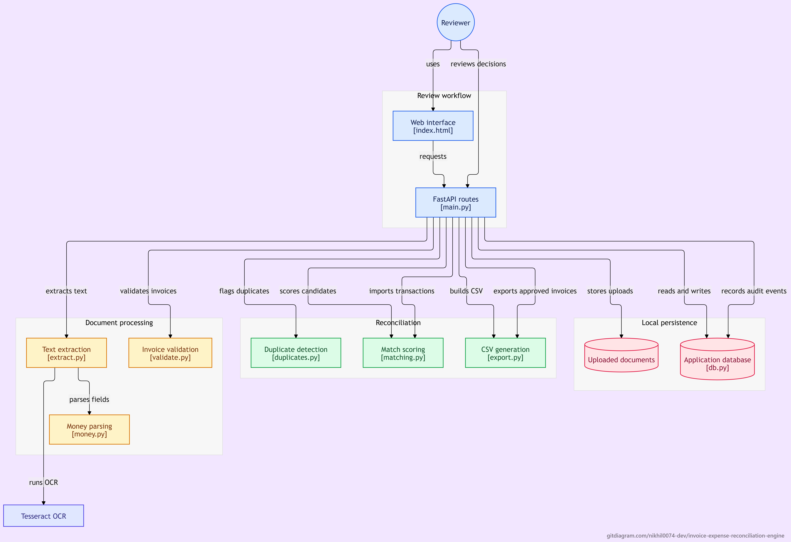
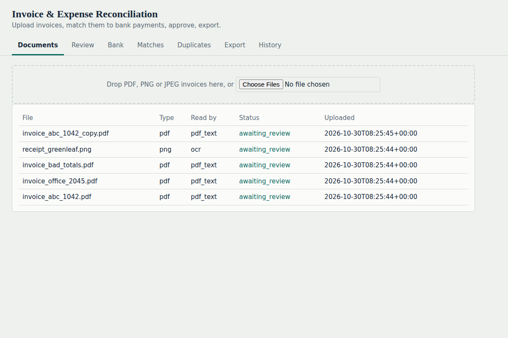
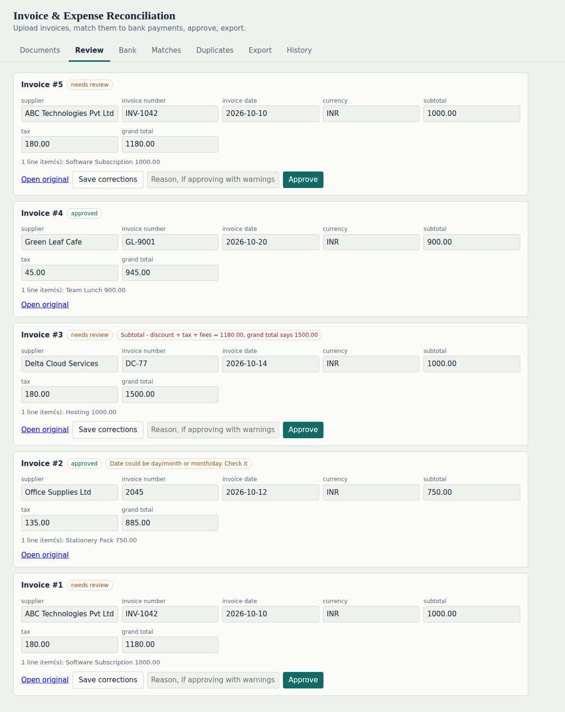
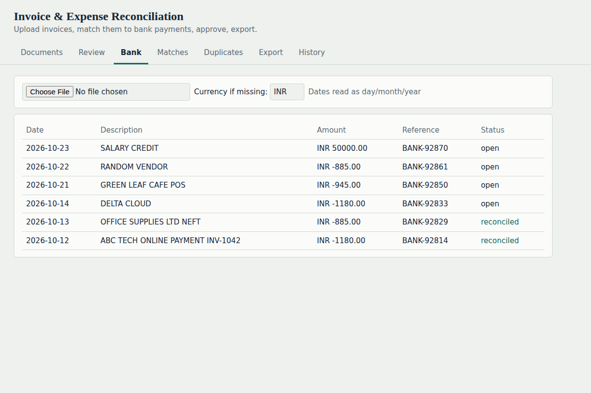
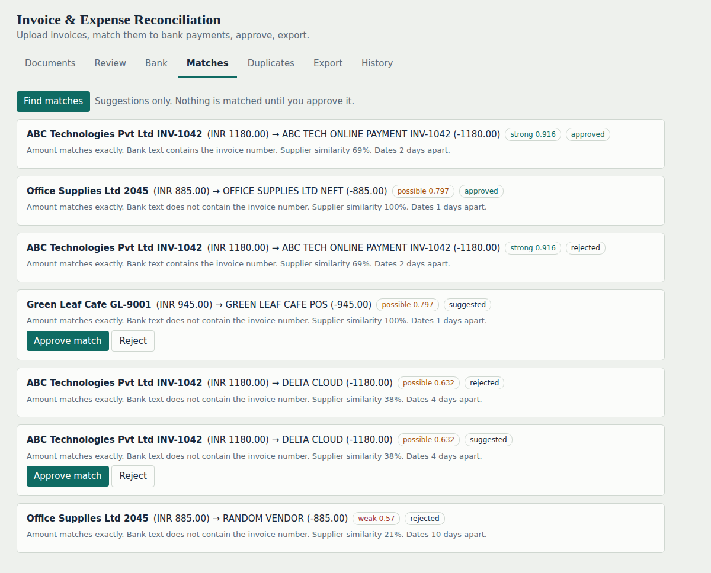
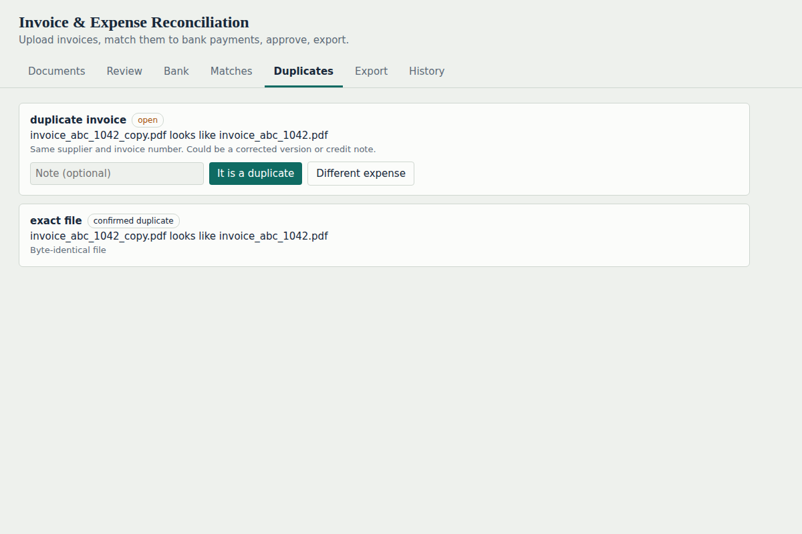
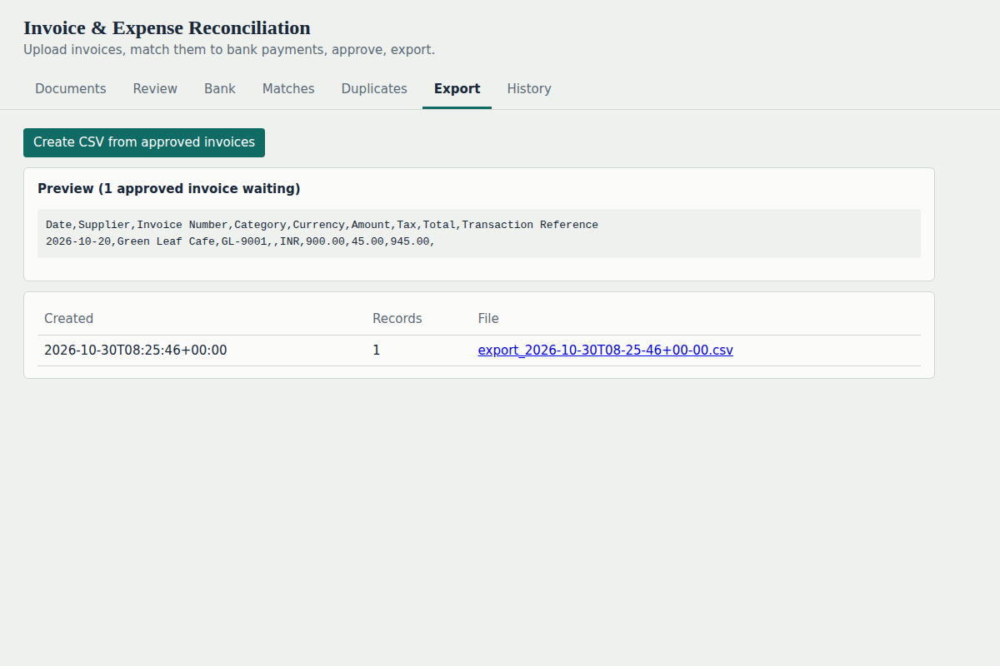
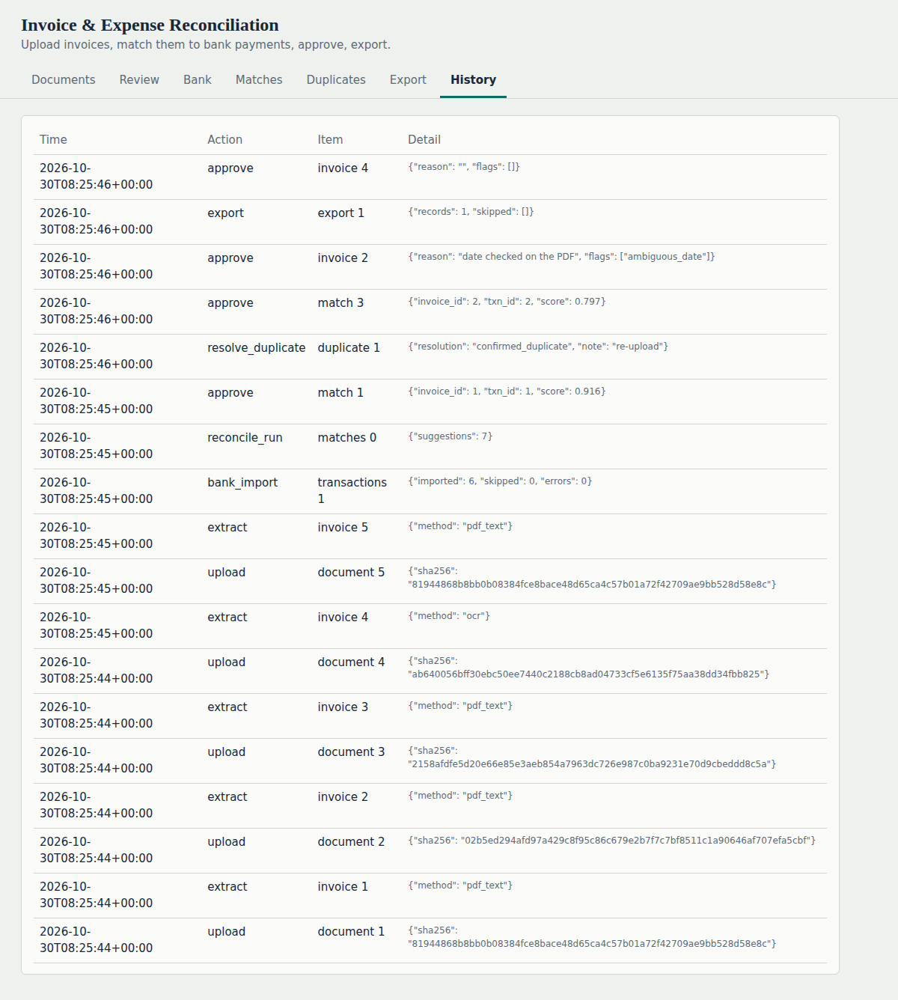

# Invoice & Expense Reconciliation Engine

A local-first MVP for reviewing invoices and receipts, importing bank transactions, identifying possible duplicates, suggesting invoice-to-payment matches, and exporting approved records as CSV. Extraction and matching are assistive only: a person reviews and approves every invoice, duplicate decision, and reconciliation.

> **Important:** This project is not an accounting system or a fraud detector. It has no authentication or organization separation. Use synthetic or otherwise appropriate data, keep the service on a trusted machine, and verify every extraction, match, and export before relying on it.











## Features

- Upload PDF, PNG, and JPEG invoice or receipt files. File type is checked from its contents rather than its extension.
- Extract text from digital PDFs; use OCR for scanned PDFs and image files.
- Parse common invoice fields, line items, dates, amounts, and currencies using rules and labels.
- Validate line calculations and invoice totals, and show missing or ambiguous fields as review flags.
- Import bank transaction CSV files, recognize common column-name aliases, report invalid rows, and avoid re-importing identical transaction rows.
- Generate ranked invoice-to-transaction suggestions with amount, supplier, date, and reference evidence. Suggestions are never automatically approved.
- Flag exact-file duplicates, repeated supplier/invoice numbers, and possible repeated expenses for human review.
- Edit extracted fields, approve invoices with an explanation when warnings exist, approve or reject match suggestions, and resolve duplicate warnings.
- Preview and download a generic CSV containing approved invoices that have not already been exported. Text fields are guarded against spreadsheet formula injection.
- Keep an audit trail of application actions.

## Workflow

1. Start the local web application and open the **Documents** tab.
2. Upload PDF, PNG, or JPEG files. A readable digital PDF is processed as PDF text; scans and images require OCR.
3. Open **Review**. Check the original file, correct extracted fields, and resolve any duplicate warnings. An invoice with warnings requires an approval reason; a missing grand total cannot be approved.
4. Open **Bank** and import a UTF-8 CSV. Set the default currency if the file has no currency column.
5. Open **Matches** and select **Find matches**. Inspect the displayed evidence, then approve or reject suggestions manually.
6. Resolve open duplicate warnings in **Duplicates**. An invoice cannot be approved while an associated duplicate warning remains open.
7. In **Export**, inspect the preview and create a CSV from eligible approved invoices. Download a created export from the export history.
8. Review **History** for recent audit events.

## Requirements

- Python 3.10 or newer.
- Packages listed in `requirements.txt`, installed by the run scripts or manually with pip.
- Tesseract OCR installed and available on `PATH` to process image files and scanned PDF pages. Digital PDFs with extractable text do not need OCR.
- For Hindi or Marathi OCR, install the corresponding Tesseract language data and set `OCR_LANGUAGES` to `eng+hin` or `eng+mar` (or `eng+hin+mar`). Only English OCR has been tested in this project.
- Optional for screenshots: Playwright's Chromium browser, installed with `playwright install chromium`.

## Run locally

### Windows

Run `run_windows.bat`, or from PowerShell:

```powershell
.\run_windows.bat
```

### macOS and Linux

```sh
chmod +x run.sh
./run.sh
```

The scripts create a `.venv` virtual environment if missing, install `requirements.txt`, and start Uvicorn on port `8000`. Then open <http://127.0.0.1:8000> in a browser. The SQLite database and uploaded files are created under `data/` by default.

To set up and run manually:

```sh
python -m venv .venv
# Activate the virtual environment for your shell, then:
python -m pip install -r requirements.txt
python -m uvicorn backend.app.main:app --host 127.0.0.1 --port 8000
```

The API is served by FastAPI. Its interactive API schema is available at <http://127.0.0.1:8000/docs> while the server is running.

## Configuration

The application reads the following environment variables at runtime. Defaults are shown in `.env.example`:

| Variable | Default | Description |
| --- | --- | --- |
| `DB_PATH` | `data/app.db` | Path to the SQLite database file. Parent directories are created automatically. |
| `STORAGE_DIR` | `data/files` | Directory for uploaded document bytes. |
| `MAX_UPLOAD_MB` | `20` | Maximum accepted upload size in megabytes. |
| `MAX_PAGES` | `30` | Maximum number of pages accepted in a PDF. |
| `OCR_LANGUAGES` | `eng` | Tesseract language codes used for OCR. |

The example file is a template; the application does not automatically load `.env` files. Set variables in the shell before launching, or use a tool that loads the file. For example, in PowerShell:

```powershell
$env:OCR_LANGUAGES = "eng+hin+mar"
.\run_windows.bat
```

In macOS or Linux:

```sh
OCR_LANGUAGES=eng+hin+mar ./run.sh
```

Do not put credentials or other secrets in source control. This application currently has no credential-management feature and is intended to run locally.

## Use the application

### Upload and review documents

The upload area accepts PDF, PNG, and JPEG files. Individual uploads over `MAX_UPLOAD_MB` are rejected. PDFs with more than `MAX_PAGES` are rejected during extraction. Encrypted, malformed, unsupported, or unreadable documents can fail extraction; failed uploads appear in the Documents list with an error.

Extraction is intentionally conservative: missing values remain blank rather than being invented. Currency detection does not infer a currency from an ambiguous bare `$`. Date formats that could be day-first or month-first may be flagged for review. Always compare the extracted values with the source document.

The editable invoice fields are supplier, invoice number, invoice date, due date, currency, subtotal, discount, tax, fees, grand total, and category. Approved invoices are locked against edits. If an invoice has warnings, supply a reason to approve it. A missing grand total blocks approval regardless of reason.

### Import bank transactions

The importer expects a UTF-8 CSV with a header row and at least a date, description, and amount column. Amount may be a signed `amount` field or separate `debit` and/or `credit` fields. Common headers such as `transaction date`, `narration`, `withdrawal`, `deposit`, `ref no`, and `transaction id` are recognized. If no currency column is present, the API and web interface use INR by default; choose the appropriate default currency before importing.

Invalid dates or amounts are reported by row. Repeated rows in a single file are retained as separate transactions, while a repeated import of the same content is skipped. Verify the imported rows and their signs/currencies before reconciling.

### Reconcile and export

Select **Find matches** to calculate suggestions. The candidate rules require the same known currency and either an exact amount (within one cent) or an invoice-number reference in the bank description/reference. Consequently, partial payments are not matched. Match scores use starting weights and should not be treated as calibrated probabilities or a validated confidence measure.

Exports use a generic CSV profile with columns for date, supplier, invoice number, category, currency, subtotal, tax, total, and transaction reference. Records missing required values are reported and excluded. Check the CSV against your accounting application's import requirements before using it. An invoice is marked exported after inclusion, so subsequent exports do not include it again.

## HTTP API

All routes are served from the same origin as the web UI. Interactive request and response schemas are available at `/docs`.

| Method | Path | Purpose |
| --- | --- | --- |
| `POST` | `/api/documents` | Upload and extract one document (`multipart/form-data`, field `file`). |
| `GET` | `/api/documents` | List uploaded documents and extraction states. |
| `GET` | `/api/documents/{doc_id}/file` | Retrieve the stored original document. |
| `GET` | `/api/invoices` | List extracted invoices and review flags. |
| `PATCH` | `/api/invoices/{inv_id}` | Edit allowed invoice fields before approval. |
| `POST` | `/api/invoices/{inv_id}/approve` | Approve an invoice; send JSON such as `{"reason":"checked against original"}` when warnings exist. |
| `POST` | `/api/bank/import` | Import bank CSV (`multipart/form-data`, field `file`); optional query parameters: `currency`, `day_first`. |
| `GET` | `/api/bank/transactions` | List imported transactions and reconciliation state. |
| `POST` | `/api/reconcile/run` | Recompute suggested matches. |
| `GET` | `/api/reconcile/matches` | List suggested and approved matches with evidence. |
| `POST` | `/api/reconcile/matches/{mid}/approve` | Approve a suggested match. |
| `POST` | `/api/reconcile/matches/{mid}/reject` | Reject a suggested match. |
| `GET` | `/api/duplicates` | List duplicate candidates and their status. |
| `POST` | `/api/duplicates/{did}/resolve` | Resolve with `{"resolution":"confirmed_duplicate"}` or `{"resolution":"distinct"}`; optional `note`. |
| `GET` | `/api/exports/preview` | Preview eligible CSV data and rows excluded for missing fields. |
| `POST` | `/api/exports` | Create an export from eligible, approved invoices. |
| `GET` | `/api/exports` | List created exports. |
| `GET` | `/api/exports/{eid}/download` | Download a generated CSV export. |
| `GET` | `/api/audit` | List up to the latest 200 audit events. |

A concise upload example using curl:

```sh
curl -F "file=@sample_data/invoice_abc_1042.pdf" http://127.0.0.1:8000/api/documents
```

## Sample data

`sample_data/` contains synthetic invoices, a synthetic receipt, and a bank transaction CSV for trying the workflow. It includes a deliberately mismatched invoice total and an exact copy of one sample invoice to demonstrate warnings and duplicate detection. Do not treat these examples as real financial records.

Regenerate the samples with:

```sh
python scripts/make_samples.py sample_data
```

The script overwrites its generated sample files in the specified output directory. The receipt is an image and requires working OCR to extract its text.

## Tests 

Run the test suite from the project root:

```sh
python -m pytest backend/tests -v
```

The OCR image test is skipped when the Tesseract executable is unavailable. Tests use temporary databases and storage configured by the test fixtures.

## Data storage and privacy

By default, SQLite data is stored in `data/app.db` and uploaded document bytes in `data/files/`. Both locations are ignored by Git through `.gitignore`. Back up or remove these locations deliberately; deleting the database alone does not remove uploaded files. The audit log records actions but is not an access-control mechanism.

There is no login, role model, tenant isolation, or built-in remote storage. The default run scripts bind Uvicorn to its normal default host; for strictly local use, run it with `--host 127.0.0.1` as in the manual command. Do not expose the service to an untrusted network or upload sensitive records unless the deployment is protected appropriately.

## Known limitations

- This is a working MVP, not production-ready financial software.
- No authentication, roles, multi-organization separation, or user attribution beyond a local audit label.
- SQLite and a single application process are used; there is no PostgreSQL, task queue, or background OCR worker. OCR runs during the upload request.
- Invoice extraction is rule-based and works best on simple, clearly labeled layouts. Complex real-world documents need additional parsing rules and testing.
- OCR results depend on scan quality and installed Tesseract language data. Hindi and Marathi OCR are configurable but have not been validated here.
- Matching thresholds and weights are initial values, not tuned or validated against real transaction data. Matching does not support split or partial payments.
- Duplicate detection creates review candidates; it does not establish fraud or determine whether an expense is actually duplicated.
- The export is a generic CSV, not a tested integration with any particular accounting system.
- Accuracy has not been measured on real documents. No accuracy claim should be inferred from the synthetic tests.

## Project layout

```text
backend/
  app/              FastAPI routes, extraction, validation, matching, storage, and static UI
  tests/            API and unit tests
sample_data/        Synthetic invoices, receipt, and bank CSV
scripts/            Sample generation and screenshot automation
docs/screenshots/   UI screenshots
.env.example        Example environment-variable values
requirements.txt    Python dependencies
run.sh              macOS/Linux setup and launch script
run_windows.bat     Windows setup and launch script
```
